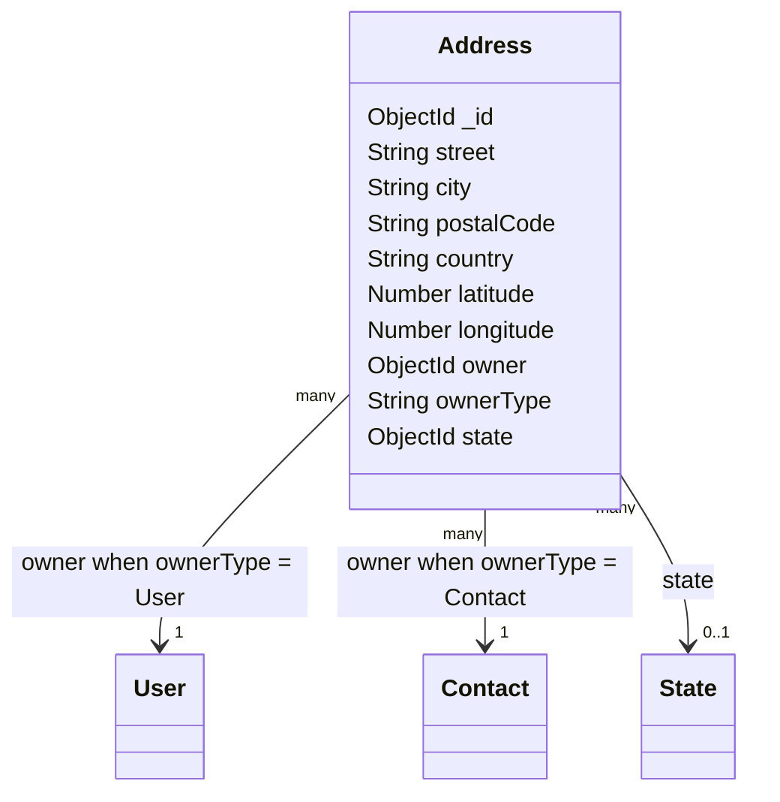
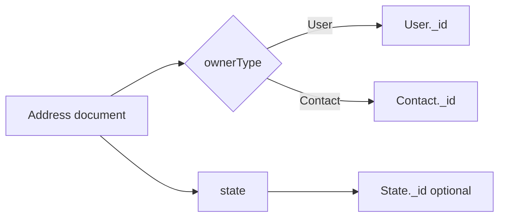
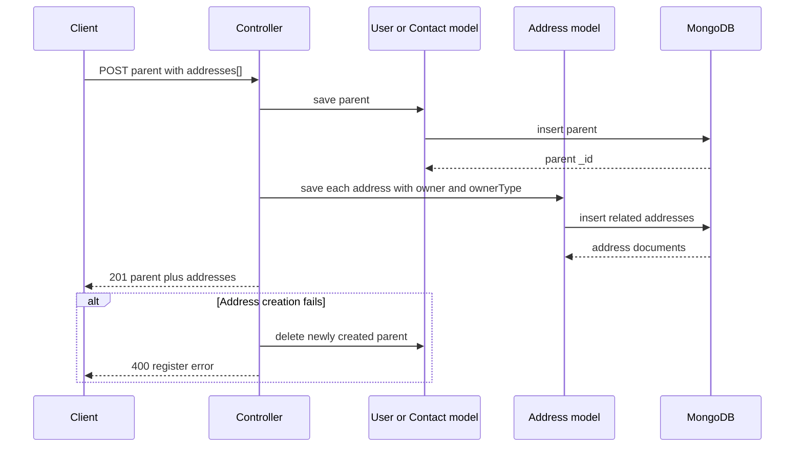

# Address model

## Overview

`Address` represents a physical or geographic address associated with an application owner.
An address can belong to either a `User` or a `Contact`. The model uses a polymorphic
relationship: `owner` stores the MongoDB identifier and `ownerType` tells Mongoose which
collection must be used to resolve that identifier.

The model is created through the `OwlModel` factory:

```js
OwlModel("Address", schemaDefinition)
```

This makes the model part of the common `owl-expressjs-utils` model API, including operations
such as `save`, `getById`, `getByCoincidence`, `update`, and `delete`.

## Responsibilities

- Store street, city, postal code, and country information.
- Store optional geographic coordinates.
- Associate the address with a `User` or `Contact`.
- Associate the address with an optional `State` document.
- Support indexed owner lookups through `owner`.

The model does not geocode addresses, validate whether a postal code exists in a country, or
verify that coordinates describe the supplied textual address. Those concerns belong to the
application or an external geographic service.

## Document structure



## Fields

| Field | Mongo/Mongoose type | Required | Rules and meaning |
| --- | --- | --- | --- |
| `_id` | `ObjectId` | Generated | MongoDB identifier generated for the address. |
| `street` | `String` | No | Street and house/building information. Leading and trailing whitespace is removed with `trim`. |
| `city` | `String` | No | City or locality. Whitespace is trimmed. |
| `postalCode` | `String` | No | Postal or ZIP code. It remains a string so leading zeroes are preserved. Whitespace is trimmed. |
| `country` | `String` | No | Country name or code supplied by the client. Whitespace is trimmed. No country enum is enforced here. |
| `latitude` | `Number` | No | Latitude in the inclusive range `-90` to `90`. |
| `longitude` | `Number` | No | Longitude in the inclusive range `-180` to `180`. |
| `owner` | `ObjectId` | Yes | Identifier of the owning `User` or `Contact`. It has an index for efficient owner queries. |
| `ownerType` | `String` | Yes | Discriminator for `owner`; only `User` or `Contact` is accepted. |
| `state` | `ObjectId` | No | Reference to a `State` document. The reference is optional. |

### Coordinate rules

- `latitude` must be between `-90` and `90`.
- `longitude` must be between `-180` and `180`.
- Supplying only one coordinate is allowed by the schema.
- No precision or coordinate reference system is enforced beyond the numeric ranges.

## Polymorphic ownership

`owner` and `ownerType` must be treated as a pair:

```js
{
	owner: "665f1a000000000000000001",
	ownerType: "Contact"
}
```

When `ownerType` is `User`, `owner` points to the `User` collection. When `ownerType` is
`Contact`, it points to the `Contact` collection. The `refPath: "ownerType"` configuration
enables this dynamic reference.



Consumers must not interpret `owner` alone. They must always use `ownerType` to determine the
target collection.

## State relationship

The `state` field is a normal MongoDB reference to the `State` model:

```js
state: {
	type: Schema.Types.ObjectId,
	ref: "State",
}
```

This keeps state data separate from every address document. The `Address` schema does not
restrict state names; that policy belongs to the `State` model and the calling feature.

## API usage

The model is registered at `/address`. Its router requires authentication and exposes these
resource operations:

| Method | Endpoint | Purpose |
| --- | --- | --- |
| `POST` | `/address` | Create an address. |
| `GET` | `/address` | List addresses. |
| `GET` | `/address/:id` | Retrieve one address by identifier. |
| `PUT` | `/address/:id` | Update an address. |
| `DELETE` | `/address/:id` | Delete an address. |

All endpoints are protected by `OwlIsAuth`.

### Standalone creation

The standalone endpoint expects the ownership fields because the model requires them:

```json
{
	"street": "123 Main St",
	"city": "Austin",
	"postalCode": "78701",
	"country": "US",
	"latitude": 30.2672,
	"longitude": -97.7431,
	"owner": "665f1a000000000000000001",
	"ownerType": "Contact",
	"state": "665f1a000000000000000010"
}
```

### Nested creation through a user

When a user is registered through the user controller, addresses are supplied in the
`addresses` array. The controller assigns the new user's identifier and
`ownerType: "User"` before saving each address:

```json
{
	"name": "Ana",
	"lastname": "Lopez",
	"addresses": [
		{
			"street": "123 Main St",
			"city": "Austin",
			"postalCode": "78701",
			"country": "US"
		}
	]
}
```

### Nested creation through a contact

When a contact is created, the contact controller performs the equivalent operation and
assigns `ownerType: "Contact"`:

```json
{
	"name": "Ana Lopez",
	"addresses": [
		{
			"street": "123 Main St",
			"city": "Austin",
			"postalCode": "78701",
			"country": "US",
			"latitude": 30.2672,
			"longitude": -97.7431
		}
	]
}
```

## Creation flow

For nested user and contact creation, the parent is saved first. Related addresses are then
saved in parallel. If saving a related resource fails, the controller removes the new parent
document to avoid leaving an orphaned parent record.



## Querying by owner

The owner index is used by the controllers to retrieve addresses without scanning the full
collection. Queries must include both ownership values:

```js
addressModel.getByCoincidence({
	owner: userId,
	ownerType: "User",
});
```

For contacts, use `ownerType: "Contact"`. The contact controller also batches address lookups
for multiple contacts and groups results by `owner` to avoid one query per contact.

## Validation and limitations

- `owner` and `ownerType` are the only required address fields.
- `ownerType` rejects values other than `User` and `Contact`.
- Text fields are trimmed but are not required and have no maximum length in this schema.
- Coordinates reject values outside their geographic ranges.
- `state` is optional.
- The schema does not enforce that the referenced `owner` document exists.
- The schema does not enforce that the referenced `state` document exists.
- Authorization is provided by route middleware and controllers, not by the model itself.

## Related files

- `models/address/address.js`: schema and model definition.
- `routes/address.js`: authenticated CRUD routes.
- `config.js`: registers the model at `/address`.
- `controllers/user.js`: creates and loads addresses belonging to users.
- `controllers/contact.js`: creates and loads addresses belonging to contacts.
- `models/state.js`: referenced state model.
