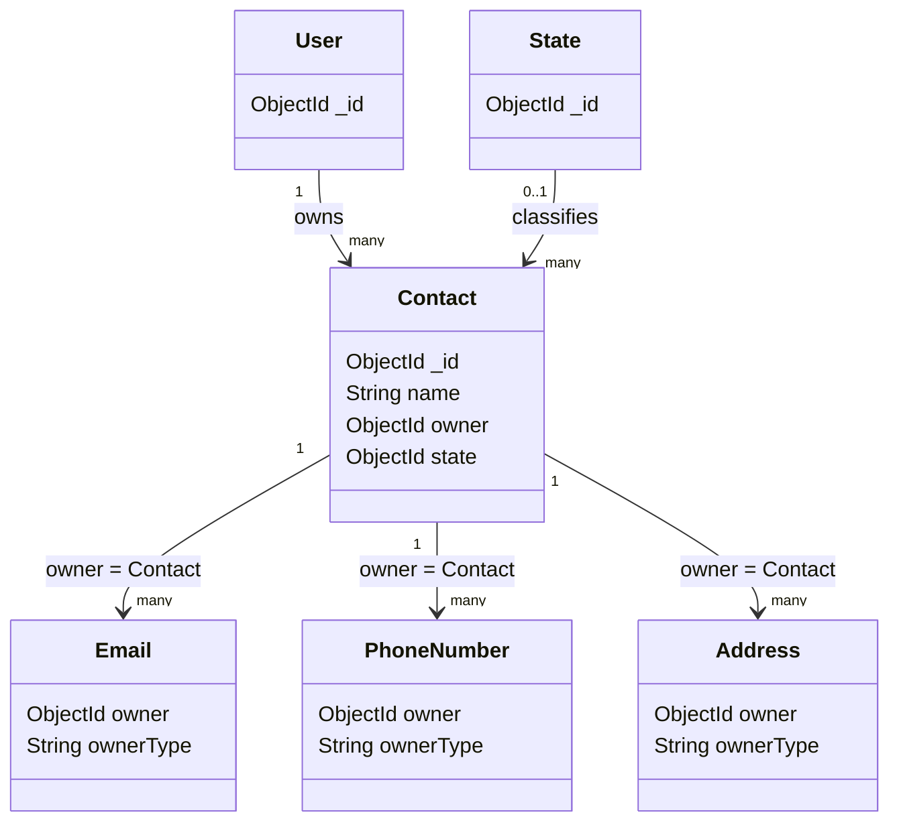
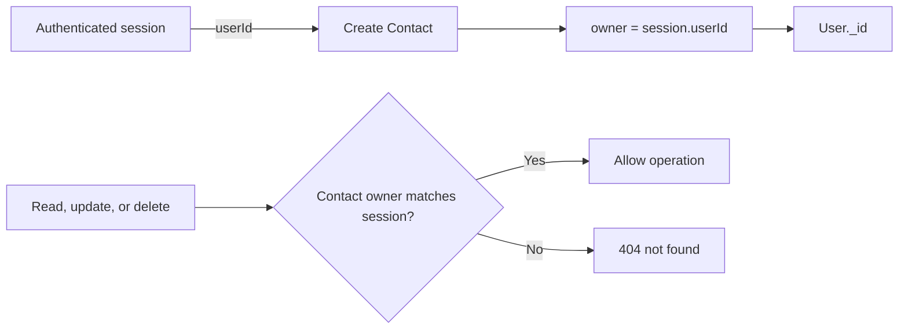
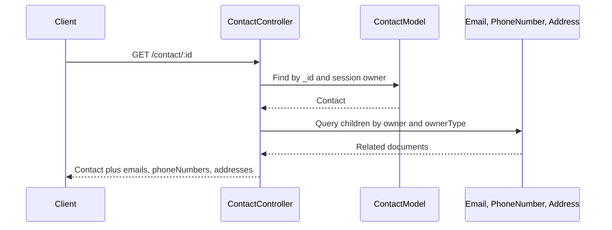
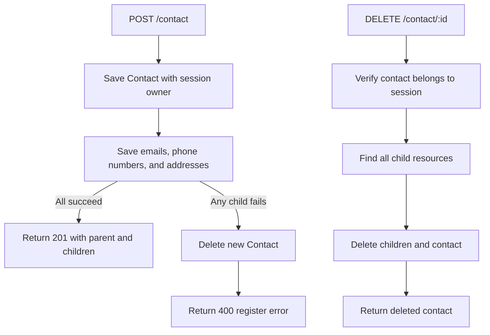

# Contact model

## Overview

`Contact` represents a person or contact entry stored in the messenger application. A contact
belongs to exactly one authenticated `User`, identified by the `owner` field. A contact can
also have related emails, phone numbers, and addresses, which are stored as separate documents
and linked through their own ownership fields.

The model is created through the `OwlModel` factory:

```js
OwlModel("Contact", schemaDefinition)
```

This provides the common model operations from `owl-expressjs-utils`, such as `save`,
`getById`, `getOne`, `getByCoincidence`, `update`, and `delete`.

## Responsibilities

- Store the contact's display name.
- Associate the contact with the authenticated user who owns it.
- Optionally classify the contact with a `State` reference.
- Serve as the parent of related emails, phone numbers, and addresses.
- Scope contact reads, updates, and deletes to the owning user through the controller.

The model stores only the contact record itself. Email addresses, phone numbers, and physical
addresses are not embedded in this document; they are loaded and persisted by the contact
controller as related resources.

## Document structure



## Fields

| Field | Mongo/Mongoose type | Required | Rules and meaning |
| --- | --- | --- | --- |
| `_id` | `ObjectId` | Generated | MongoDB identifier generated for the contact. |
| `name` | `String` | Yes | Contact display name. The value is trimmed. If absent, validation returns `El nombre del contacto es obligatorio.` |
| `owner` | `ObjectId` | Yes | User identifier that owns the contact. It references `User` and is indexed for owner queries. |
| `state` | `ObjectId` | No | Optional reference to a `State` document. |

## Ownership and authorization

The model's `owner` reference points directly to `User`:

```js
owner: {
	type: Schema.Types.ObjectId,
	ref: "User",
	required: true,
	index: true,
}
```

For contact creation, the controller ignores any client-provided owner and uses the current
session user:

```js
owner: req.session.userId
```

The contact controller also includes the session user in read, update, and delete queries.
This prevents one authenticated user from accessing another user's contacts by guessing an
identifier.



## State relationship

`state` is an optional reference to the `State` model:

```js
state: {
	type: Schema.Types.ObjectId,
	ref: "State",
}
```

The contact schema does not define the allowed state names. State semantics are controlled by
the `State` model and the feature that assigns the state.

## Related resources

Contact children are stored outside the contact document:

| Resource | Ownership assigned when nested under a contact |
| --- | --- |
| `Email` | `owner: contact._id`, `ownerType: "Contact"` |
| `PhoneNumber` | `owner: contact._id`, `ownerType: "Contact"` |
| `Address` | `owner: contact._id`, `ownerType: "Contact"` |

When retrieving one contact, the controller performs one batched lookup for each child type,
then groups the results by `owner`. This avoids issuing one query per child or one query per
contact when retrieving multiple records.



## API usage

The model is exposed through `/contact`. The router requires authentication for every
operation:

| Method | Endpoint | Purpose |
| --- | --- | --- |
| `POST` | `/contact` | Create a contact, optionally with child resources. |
| `GET` | `/contact` | List contacts owned by the current user. |
| `GET` | `/contact/:id` | Retrieve one owned contact with its child resources. |
| `PUT` | `/contact/:id` | Update one owned contact. |
| `DELETE` | `/contact/:id` | Delete one owned contact and its child resources. |

### Create a contact

The contact controller accepts child collections in the request body. `owner` and
`ownerType` are assigned by the server for each child:

```json
{
	"name": "Ana Lopez",
	"state": "665f1a000000000000000010",
	"emails": [
		"ana@example.com"
	],
	"phoneNumbers": [
		{
			"phone": "+15125550123",
			"countryNumber": "+1"
		}
	],
	"addresses": [
		{
			"street": "123 Main St",
			"city": "Austin",
			"postalCode": "78701",
			"country": "US"
		}
	]
}
```

The response contains the created contact and the created child documents:

```json
{
	"_id": "665f1a000000000000000001",
	"name": "Ana Lopez",
	"owner": "665f1a000000000000000002",
	"emails": [],
	"phoneNumbers": [],
	"addresses": []
}
```

The child arrays above are illustrative. The actual response contains the documents created
from the request, including their generated identifiers and ownership fields.

## Creation and deletion behavior

Contact creation saves the parent first and then saves emails, phone numbers, and addresses
in parallel. If any child save fails, the newly created contact is deleted to avoid leaving an
orphaned parent.

Deleting a contact also deletes all emails, phone numbers, and addresses whose owner is that
contact. The deletion is implemented by the contact controller; it is not a MongoDB schema
cascade or a model hook.



## Validation and limitations

- `name` is the only contact-specific required field.
- `name` is trimmed but has no maximum length in this schema.
- `owner` is required and must reference a `User` identifier.
- `state` is optional and the referenced document is not validated for existence by this schema.
- Child resource ownership is assigned by controllers during nested creation.
- Authorization and ownership checks are controller/router responsibilities, not model behavior.

## Related files

- `models/contact/contact.js`: schema and model definition.
- `routes/contact.js`: authenticated contact routes.
- `controllers/contact.js`: ownership checks, child loading, nested creation, and cascade deletion.
- `models/email/email.js`: email child model.
- `models/phoneNumber.js`: phone number child model.
- `models/address/address.js`: address child model.
- `models/state.js`: referenced state model.
