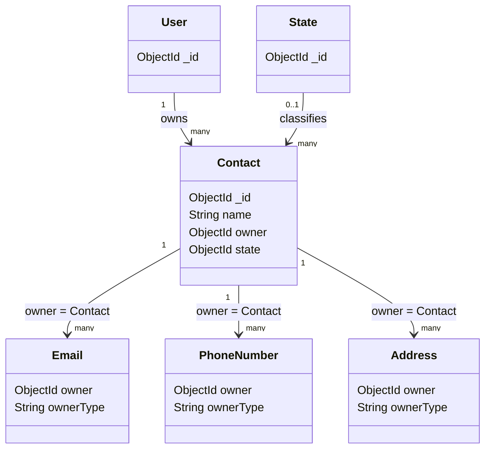

# Contact model

## Overview

`Contact` represents a person or contact entry stored in the messenger application. A contact
belongs to exactly one authenticated `User`, identified by the `owner` field. A contact can
also have related emails, phone numbers, and addresses, which are stored as separate documents
and linked through their own ownership fields.

The model is created through the `OwlModel` factory:

```js
OwlModel("Contact", schemaDefinition)
```

This provides the common model operations from `owl-expressjs-utils`, such as `save`,
`getById`, `getOne`, `getByCoincidence`, `update`, and `delete`.

## Responsibilities

- Store the contact's display name.
- Associate the contact with the authenticated user who owns it.
- Optionally classify the contact with a `State` reference.
- Serve as the parent of related emails, phone numbers, and addresses.
- Scope contact reads, updates, and deletes to the owning user through the controller.

The model stores only the contact record itself. Email addresses, phone numbers, and physical
addresses are not embedded in this document; they are loaded and persisted by the contact
controller as related resources.

## Document structure



## Fields

| Field | Mongo/Mongoose type | Required | Rules and meaning |
| --- | --- | --- | --- |
| `_id` | `ObjectId` | Generated | MongoDB identifier generated for the contact. |
| `name` | `String` | Yes | Contact display name. The value is trimmed. If absent, validation returns `El nombre del contacto es obligatorio.` |
| `owner` | `ObjectId` | Yes | User identifier that owns the contact. It references `User` and is indexed for owner queries. |
| `state` | `ObjectId` | No | Optional reference to a `State` document. |

## State relationship

`state` is an optional reference to the `State` model:

```js
state: {
	type: Schema.Types.ObjectId,
	ref: "State",
}
```

The contact schema does not define the allowed state names. State semantics are controlled by
the `State` model and the feature that assigns the state.

## Validation and limitations

- `name` is the only contact-specific required field.
- `name` is trimmed but has no maximum length in this schema.
- `owner` is required and must reference a `User` identifier.
- `state` is optional and the referenced document is not validated for existence by this schema.
- Child resource ownership is assigned by controllers during nested creation.
- Authorization and ownership checks are controller/router responsibilities, not model behavior.

## Related files

- `models/contact/model.js`: schema and model definition.
- `routes/contact.js`: authenticated contact routes.
- `controllers/contact.js`: ownership checks, child loading, nested creation, and cascade deletion.
- `models/email/model.js`: email child model.
- `models/phoneNumber/model.js`: phone number child model.
- `models/address/model.js`: address child model.
- `models/state/model.js`: referenced state model.
