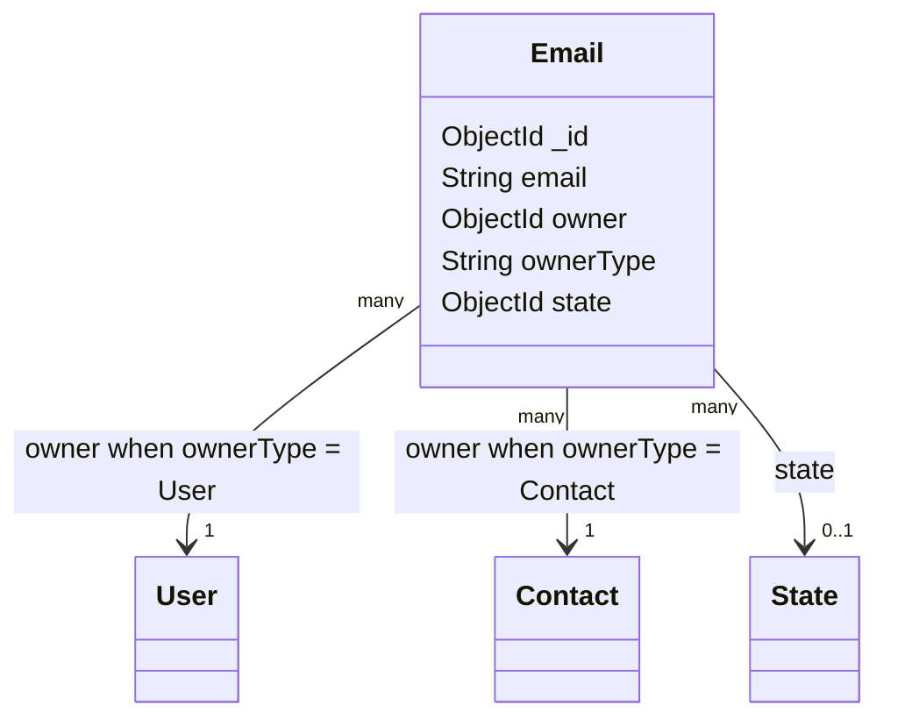
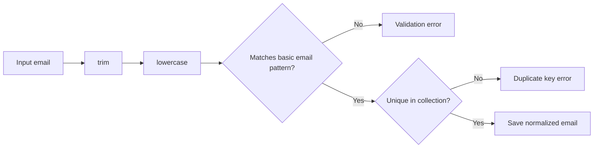
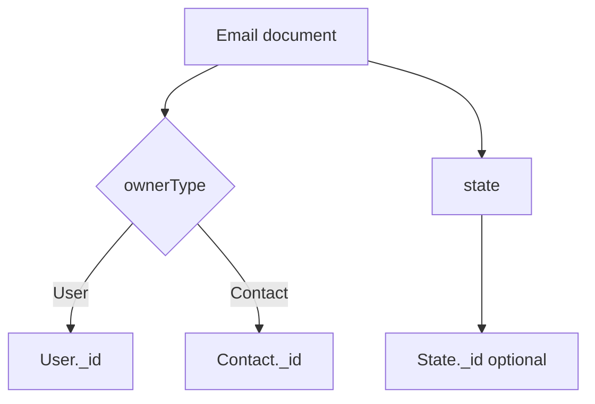

# Email model

## Overview

`Email` stores one email address and associates it with either a `User` or a `Contact`.
It is a separate resource rather than an embedded field so the same ownership pattern can be
used for user emails and contact emails.

The model is created through the `OwlModel` factory:

```js
OwlModel("Email", schemaDefinition)
```

This provides the common `owl-expressjs-utils` model operations, including `save`, `getById`,
`getOne`, `getByCoincidence`, `update`, and `delete`.

## Responsibilities

- Store a normalized email address.
- Validate the basic email format.
- Enforce uniqueness of the email value in the collection.
- Associate the email with a `User` or `Contact` through a polymorphic owner reference.
- Optionally associate the email with a `State` document.

The model does not verify mailbox ownership, send a confirmation message, or guarantee that the
mailbox exists. Those operations belong to application services outside this schema.

## Document structure



## Fields

| Field | Mongo/Mongoose type | Required | Rules and meaning |
| --- | --- | --- | --- |
| `_id` | `ObjectId` | Generated | MongoDB identifier generated for the email document. |
| `email` | `String` | Yes | Email value. It is trimmed, converted to lowercase, validated by regex, and marked unique. |
| `owner` | `ObjectId` | Yes | Identifier of the owning `User` or `Contact`. It has an index for owner lookups. |
| `ownerType` | `String` | Yes | Dynamic reference discriminator; only `User` or `Contact` is accepted. |
| `state` | `ObjectId` | Yes | Reference to a `State` document. |

## Email normalization and validation

The `email` field uses the following Mongoose options:

```js
{
	required: [true, "El correo electrónico es obligatorio."],
	unique: true,
	trim: true,
	lowercase: true,
	match: [/^\S+@\S+\.\S+$/, "El formato del correo electrónico no es válido."],
}
```

The practical processing order is:

1. Leading and trailing whitespace is removed.
2. The value is converted to lowercase.
3. The value must match the basic `local-part@domain.tld` pattern.
4. MongoDB uniqueness prevents duplicate stored values when the unique index is present.

For example, ` Ana@Example.COM ` is stored as `ana@example.com`.

The regular expression is intentionally basic. It is not a complete implementation of every
format permitted by the email standards, and it does not validate DNS or mailbox existence.



## Polymorphic ownership

`owner` and `ownerType` must be used together:

```js
{
	owner: "665f1a000000000000000001",
	ownerType: "Contact"
}
```

The `refPath: "ownerType"` setting resolves `owner` against `User` when
`ownerType` is `User`, or against `Contact` when it is `Contact`.



The schema does not guarantee that the referenced owner exists. Ownership and authorization
must be checked by the relevant controller.

## State relationship

`state` is an optional reference to `State`:

```js
state: {
	type: Schema.Types.ObjectId,
	ref: "State",
}
```

The `Email` model does not define which state names are valid. That policy is owned by the
`State` model and the feature assigning the state.

## Validation and limitations

- `email`, `owner`, and `ownerType` are required.
- Email values are trimmed and lowercased before persistence.
- The format check is basic and does not verify DNS or mailbox existence.
- `unique: true` relies on a MongoDB unique index; duplicate writes can still surface as database errors.
- `ownerType` accepts only `User` and `Contact`.
- The schema does not enforce that `owner` or `state` references an existing document.
- Authentication and authorization are route/controller concerns, not model concerns.

## Related files

- `models/email/model.js`: schema and model definition.
- `routes/email.js`: email CRUD routes and authentication boundary.
- `config.js`: registers the model at `/email`.
- `controllers/contact.js`: creates, loads, and removes contact-owned emails.
- `controllers/user.js`: creates user-owned emails during registration.
- `models/state/model.js`: referenced state model.
