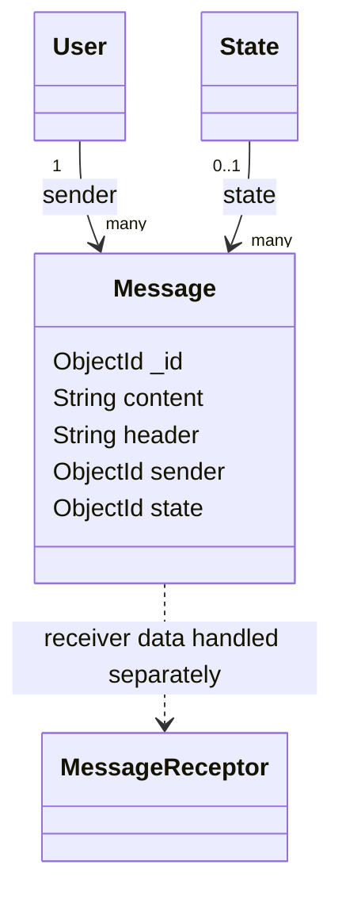

# Message model

## Overview

`Message` stores a text message sent by a `User` and an optional `State` reference. Message
delivery to WhatsApp is handled by `controllers/message.js`; the model itself only describes
the persisted message fields.

The model is created through the `OwlModel` factory:

```js
OwlModel("Message", schemaDefinition)
```

## Responsibilities

- Store the message header and content.
- Associate the message with its user sender.
- Optionally associate a state.
- Provide the generic message CRUD operations and the custom send flow.

The schema does not send messages, validate a phone number, or track provider delivery status.

## Document structure



## Fields

| Field | Mongo/Mongoose type | Required | Rules and meaning |
| --- | --- | --- | --- |
| `_id` | `ObjectId` | Generated | MongoDB identifier generated for the message. |
| `content` | `String` | Yes | Message body. Whitespace is trimmed. |
| `header` | `String` | Yes | Message header or subject. Whitespace is trimmed. |
| `sender` | `ObjectId` | Yes | Reference to the sending `User`. |
| `state` | `ObjectId` | No | Optional reference to a `State` document. |

## API usage

All message routes require authentication:

| Method | Endpoint | Purpose |
| --- | --- | --- |
| `POST` | `/message/send` | Send text through the Meta WhatsApp API and optionally persist it. |
| `POST` | `/message` | Create a message through generic model operations. |
| `GET` | `/message` | List messages. |
| `GET` | `/message/:id` | Retrieve one message. |
| `PUT` | `/message/:id` | Update one message. |
| `DELETE` | `/message/:id` | Delete one message. |

### Sending through WhatsApp

`POST /message/send` accepts the destination as `to` or `recipientPhoneNumber` and the body as
`content`, `message`, or `text`. It requires a `phoneNumberId` and a WhatsApp token. The token
is preferred from the authenticated user and falls back to `body.whatsappToken`.

```json
{
	"to": "15551234567",
	"content": "Hola",
	"phoneNumberId": "meta-phone-number-id",
	"receiver": ["665f1a000000000000000001"]
}
```

The controller sends a text payload to Meta. When `receiver` is present, it also calls
`Message.save` with the authenticated user as `sender`.

## Receiver limitation

The current schema does not declare a `receiver` field, although the send controller passes a
`receiver` array to `model.save` and `config.js` lists `receiver` as a populated field. The
`MessageReceptor` model exists with explicit `message` and `contact` references, but it is not
registered in `config.js` and is not used by the current send controller. This documentation
therefore describes `receiver` as controller input, not as a declared `Message` schema field.

## Validation and limitations

- `content`, `header`, and `sender` are required by the schema.
- Text values are trimmed but have no maximum length.
- `state` is optional and its referenced document is not verified by the schema.
- The schema does not track delivery, failure, provider message IDs, or timestamps explicitly.
- Sending depends on Meta configuration and does not itself guarantee final delivery.
- Authentication is supplied by `OwlIsAuth`; authorization and recipient persistence require controller support.

## Related files

- `models/message/message.js`: schema and model definition.
- `routes/message.js`: authenticated CRUD and send routes.
- `controllers/message.js`: Meta WhatsApp integration and optional persistence.
- `models/messageReceptor/messageReceptor.js`: separate message/contact relationship model.
- `models/tokens/tokens.js`: provider token source.
- `models/user/user.js`: sender reference.
