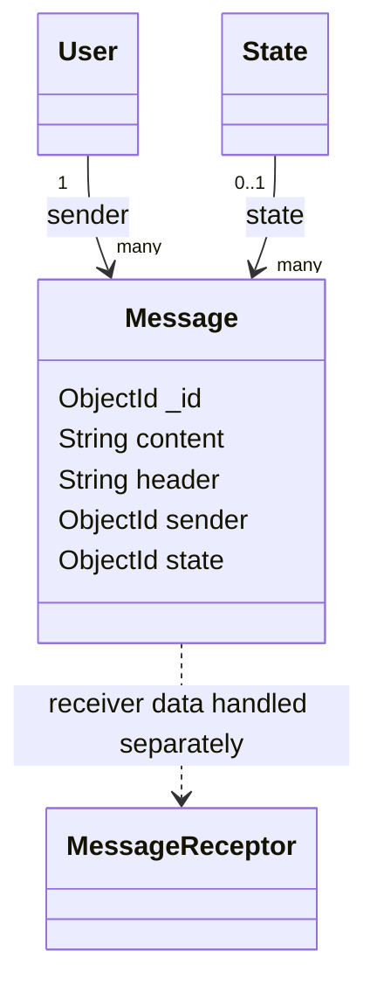

# Message model

## Overview

`Message` stores a text message sent by a `User` and an optional `State` reference. Message
delivery to WhatsApp is handled by `controllers/message.js`; the model itself only describes
the persisted message fields.

The model is created through the `OwlModel` factory:

```js
OwlModel("Message", schemaDefinition)
```

## Responsibilities

- Store the message header and content.
- Associate the message with its user sender.
- Optionally associate a state.
- Provide the generic message CRUD operations and the custom send flow.

The schema does not send messages, validate a phone number, or track provider delivery status.

## Document structure



## Fields

| Field | Mongo/Mongoose type | Required | Rules and meaning |
| --- | --- | --- | --- |
| `_id` | `ObjectId` | Generated | MongoDB identifier generated for the message. |
| `content` | `String` | Yes | Message body. Whitespace is trimmed. |
| `header` | `String` | Yes | Message header or subject. Whitespace is trimmed. |
| `sender` | `ObjectId` | Yes | Reference to the sending `User`. |
| `state` | `ObjectId` | No | Optional reference to a `State` document. |

## Validation and limitations

- `content`, `header`, and `sender` are required by the schema.
- Text values are trimmed but have no maximum length.
- `state` is optional and its referenced document is not verified by the schema.
- The schema does not track delivery, failure, provider message IDs, or timestamps explicitly.
- Sending depends on Meta configuration and does not itself guarantee final delivery.
- Authentication is supplied by `OwlIsAuth`; authorization and recipient persistence require controller support.

## Related files

- `models/message/model.js`: schema and model definition.
- `routes/message.js`: authenticated CRUD and send routes.
- `controllers/message.js`: Meta WhatsApp integration and optional persistence.
