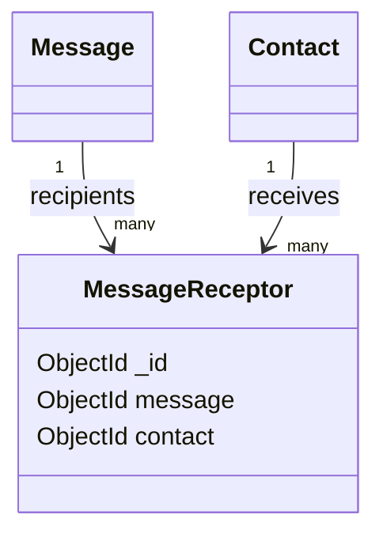

# MessageReceptor model

## Overview

`MessageReceptor` represents the relationship between a `Message` and a `Contact` who receives
it. It is a join document with two required references and no embedded message or contact
data.

The model is created through the `OwlModel` factory:

```js
OwlModel("MessageReceptor", schemaDefinition)
```

## Responsibilities

- Link one message to one contact recipient.
- Keep recipient relationships separate from message content.
- Allow a message to have multiple recipient documents.

The model does not currently have a route registration in `config.js`, so it is an internal
model until a controller or route exposes it.

## Document structure



## Fields


| Field | Mongo/Mongoose type | Required | Rules and meaning |
| --- | --- | --- | --- |
| `_id` | `ObjectId` | Generated | MongoDB identifier generated for the relationship. |
| `message` | `ObjectId` | Yes | Reference to the related `Message`. |
| `contact` | `ObjectId` | Yes | Reference to the recipient `Contact`. |

## Validation and limitations

- `message` and `contact` are required.
- The schema does not verify that either referenced document exists.
- No uniqueness constraint prevents duplicate relationships.
- No delivery status, timestamps, or provider message identifier is stored.
- Authorization and lifecycle cleanup are not implemented by this schema.

## Related files

- `models/messageReceptor/messageReceptor.js`: schema and model definition.
- `models/message/message.js`: referenced message model.
- `models/contact/contact.js`: referenced recipient model.
- `models/message.js`: message controller and send flow.
- `config.js`: imports the model but does not register a route for it.
