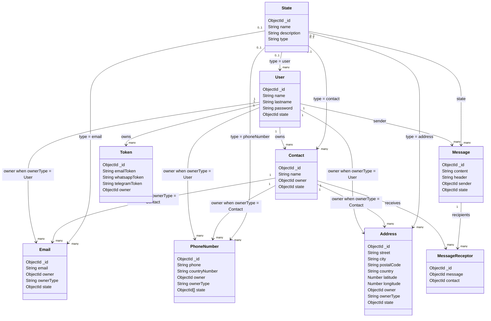
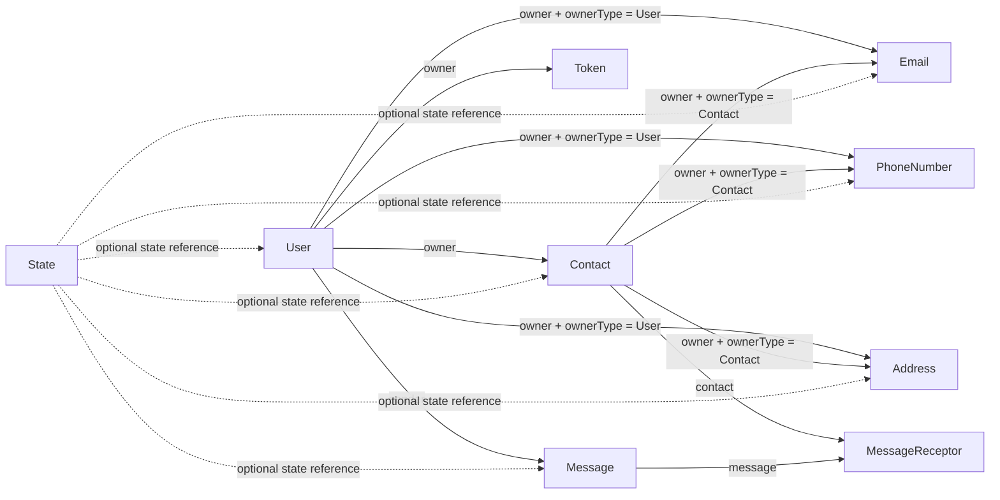
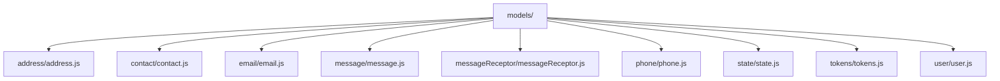

# Models

## Overview

La capa `models` define los documentos MongoDB usados por Megaphone Messenger. Todos los
modelos se construyen con `OwlModel` de `owl-expressjs-utils` y usan referencias `ObjectId`
para mantener separadas las entidades principales, los recursos relacionados y los estados.

La documentación de este archivo es un índice general. Cada modelo tiene una página propia con
sus campos, validaciones, endpoints, ejemplos y limitaciones.

## Model navigation

| Model | Purpose | Documentation |
| --- | --- | --- |
| `User` | Cuenta autenticada, credenciales e identidad del propietario. | [User model](user/user.md) |
| `Contact` | Contacto perteneciente a un usuario. | [Contact model](contact/contact.md) |
| `Email` | Correo de un usuario o contacto. | [Email model](email/email.md) |
| `PhoneNumber` | Número telefónico de un usuario o contacto. | [PhoneNumber model](phone/phone.md) |
| `Address` | Dirección de un usuario o contacto, con coordenadas opcionales. | [Address model](address/address.md) |
| `State` | Estado categórico reutilizable por varios modelos. | [State model](state/state.md) |
| `Message` | Mensaje creado por un usuario y enviado mediante la integración de WhatsApp. | [Message model](message/message.md) |
| `MessageReceptor` | Relación entre un mensaje y un contacto receptor. | [MessageReceptor model](messageReceptor/messageReceptor.md) |
| `Token` | Credenciales de proveedores de mensajería pertenecientes a un usuario. | [Token model](tokens/tokens.md) |

## Complete relationship diagram



## Ownership and reference map



## Polymorphic resources

`Email`, `PhoneNumber` y `Address` comparten el patrón de propiedad polimórfica:

```js
{
	owner: ObjectId,
	ownerType: "User" | "Contact",
}
```

El campo `owner` contiene el identificador y `ownerType` determina si debe resolverse contra
`User` o `Contact`. Estos campos siempre deben consultarse juntos; un `owner` aislado no
identifica de forma suficiente la colección de destino.

## State relationships

`State` es un modelo reutilizable. La mayoría de sus relaciones son referencias opcionales de
un solo valor; `PhoneNumber.state` es la excepción y almacena un arreglo de referencias.

El campo `State.type` acepta únicamente:

```text
address | user | contact | email | phoneNumber
```

El esquema no verifica automáticamente que un estado exista ni que su `type` sea compatible
con el documento que lo referencia.

## Messaging relationships

`Message.sender` referencia a `User`. La relación con contactos receptores está modelada por
`MessageReceptor`, que contiene `message` y `contact`, permitiendo varios receptores por
mensaje.

Actualmente `MessageReceptor` está definido pero no se registra como ruta en `config.js`. La
ruta `POST /message/send` también acepta `receiver` y lo pasa al guardado de `Message`, aunque
ese campo no está declarado en el esquema actual. La documentación detallada de [Message](message/message.md)
y [MessageReceptor](messageReceptor/messageReceptor.md) describe esta limitación.

## Model files



## Detailed documentation

- [Address](address/address.md)
- [Contact](contact/contact.md)
- [Email](email/email.md)
- [Message](message/message.md)
- [MessageReceptor](messageReceptor/messageReceptor.md)
- [PhoneNumber](phone/phone.md)
- [State](state/state.md)
- [Token](tokens/tokens.md)
- [User](user/user.md)
