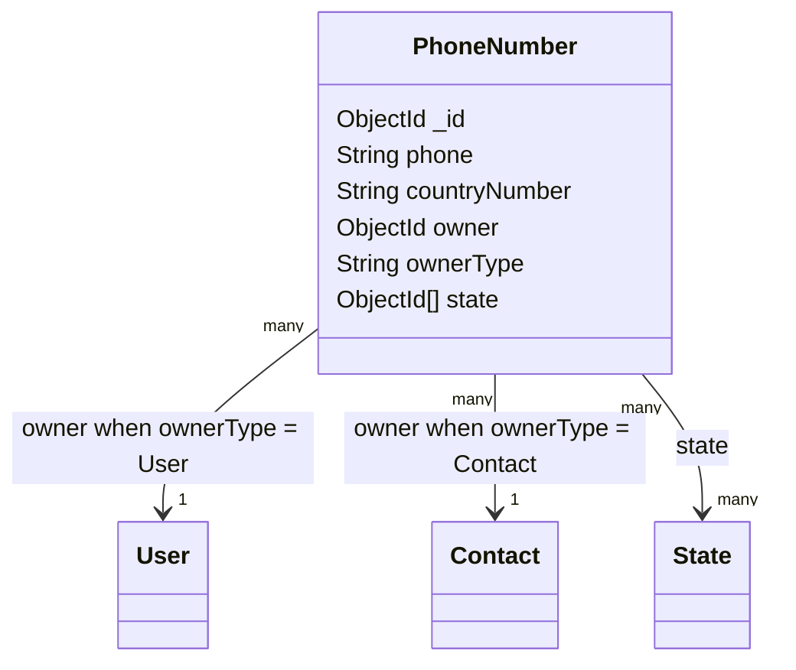

# PhoneNumber model

## Overview

`PhoneNumber` stores a phone number and associates it with either a `User` or a `Contact`.
The model uses a polymorphic owner reference: `owner` stores the identifier and `ownerType`
selects the target collection.

The model is created through the `OwlModel` factory:

```js
OwlModel("PhoneNumber", schemaDefinition)
```

## Responsibilities

- Store the phone number and its country calling code.
- Associate the number with a `User` or `Contact`.
- Associate one or more optional `State` documents with the number.
- Support indexed owner lookups.

The schema does not normalize phone formatting, verify ownership of the number, or contact the
carrier.

## Document structure



## Fields

| Field | Mongo/Mongoose type | Required | Rules and meaning |
| --- | --- | --- | --- |
| `_id` | `ObjectId` | Generated | MongoDB identifier generated for the phone document. |
| `phone` | `String` | Yes | Phone number value. Whitespace is trimmed. |
| `countryNumber` | `String` | Yes | Country calling code. Whitespace is trimmed. |
| `owner` | `ObjectId` | Yes | Identifier of the owning `User` or `Contact`; indexed for lookups. |
| `ownerType` | `String` | Yes | Dynamic reference discriminator; only `User` or `Contact` is accepted. |
| `state` | `ObjectId[]` | No | Array of references to `State` documents. |

## Polymorphic ownership

`owner` and `ownerType` must be treated as a pair:

```json
{
	"owner": "665f1a000000000000000001",
	"ownerType": "Contact"
}
```

The `refPath: "ownerType"` setting resolves the owner against `User` or `Contact`. The
referenced owner is not verified by the schema.

## Validation and limitations

- `phone`, `countryNumber`, `owner`, and `ownerType` are required.
- Text values are trimmed but have no format or maximum-length validation.
- `ownerType` accepts only `User` and `Contact`.
- `state` is an array, unlike the single-value `state` fields on several other models.
- The schema does not enforce that referenced owners or states exist.
- Authentication and authorization are route/controller concerns.

## Related files

- `models/phone/phone.js`: schema and model definition.
- `routes/phoneNumber.js`: phone-number CRUD routes.
- `controllers/user.js`: creates and loads user-owned phone numbers.
- `controllers/contact.js`: creates and loads contact-owned phone numbers.
- `models/state/state.js`: referenced state model.
