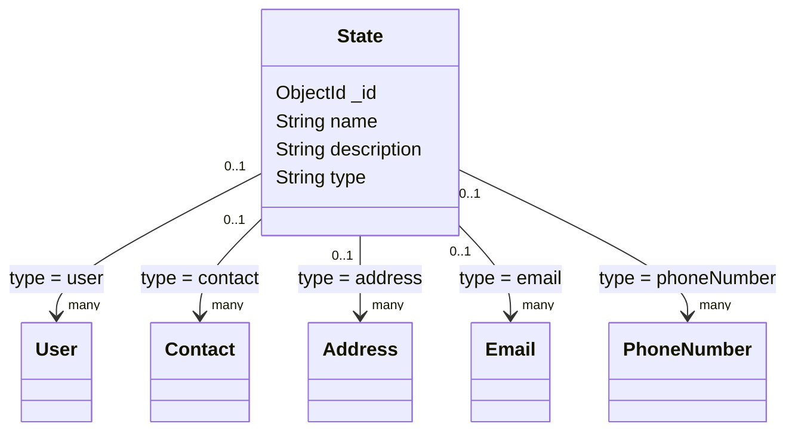

# State model

## Overview

`State` stores a categorical status and the entity family to which that status applies. Other
models reference it through an optional `ObjectId` field, allowing state definitions to remain
separate from user, contact, address, email, and phone documents.

The model is created through the `OwlModel` factory:

```js
OwlModel("State", schemaDefinition)
```

## Responsibilities

- Store a state name and optional description.
- Restrict state categories to the entity types supported by the application.
- Provide reusable state documents for other models.

The model does not automatically assign states or validate that a state is appropriate for a
particular document beyond its `type` value.

## Document structure



## Fields

| Field | Mongo/Mongoose type | Required | Rules and meaning |
| --- | --- | --- | --- |
| `_id` | `ObjectId` | Generated | MongoDB identifier generated for the state. |
| `name` | `String` | Yes | State name. No trimming or uniqueness rule is defined in the schema. |
| `description` | `String` | No | Optional description; defaults to an empty string. |
| `type` | `String` | Yes | Entity category. Allowed values are `address`, `user`, `contact`, `email`, and `phoneNumber`. |

## API usage

The state router requires authentication for both operations:

| Method | Endpoint | Purpose |
| --- | --- | --- |
| `GET` | `/state` | List states. |
| `POST` | `/state` | Create a state. |

Example:

```json
{
	"name": "active",
	"description": "Entity is active",
	"type": "contact"
}
```

## Validation and limitations

- `name` and `type` are required.
- `type` rejects values outside the five declared categories.
- `description` defaults to `""` when omitted.
- State names are not unique and are not trimmed by this schema.
- The model does not prevent assigning a state to an incompatible entity type.
- Authorization is provided by the route middleware.

## Related files

- `models/state/state.js`: schema and model definition.
- `routes/state.js`: authenticated list and create routes.
- `models/user/user.js`, `models/contact/contact.js`, `models/address/address.js`: state consumers.
- `models/email/email.js`, `models/phone/phone.js`: state consumers.
