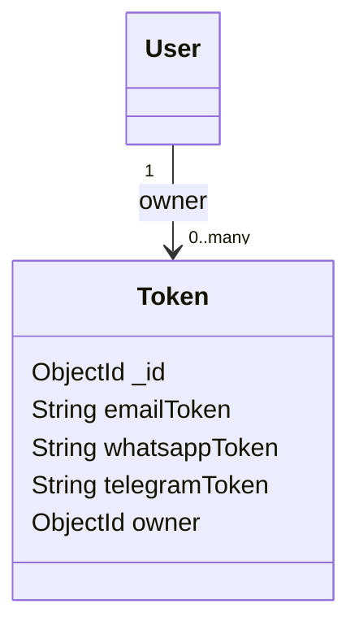

# Token model

## Overview

`Token` stores messaging-provider credentials owned by a `User`. It currently supports email,
WhatsApp, and Telegram tokens. The token fields are configured for field-level protection by
the `OwlModel` factory and should be treated as secrets.

The model is created as:

```js
OwlModel(
	"Token",
	schemaDefinition,
	["emailToken", "whatsappToken", "telegramToken"],
)
```

## Responsibilities

- Store provider credentials associated with a user.
- Keep provider token values separate from the user document.
- Support indexed lookup by user owner.

The model does not validate tokens with the providers or refresh expired credentials.

## Document structure



## Fields

| Field | Mongo/Mongoose type | Required | Rules and meaning |
| --- | --- | --- | --- |
| `_id` | `ObjectId` | Generated | MongoDB identifier generated for the token document. |
| `emailToken` | `String` | No | Email-provider credential. Whitespace is trimmed and the field is protected by `OwlModel`. |
| `whatsappToken` | `String` | No | WhatsApp credential used by message sending. Whitespace is trimmed and protected. |
| `telegramToken` | `String` | No | Telegram credential. Whitespace is trimmed and protected. |
| `owner` | `ObjectId` | Yes | User identifier that owns the credentials; indexed for lookup. |

## Validation and limitations

- Only `owner` is required.
- Provider token fields are optional and have no format or expiration validation.
- Tokens are trimmed and configured as protected fields by the model factory.
- The schema does not enforce that `owner` references an existing user.
- Route authorization is required, but ownership filtering must still be enforced by callers.

## Related files

- `models/tokens/model.js`: schema and model definition.
- `routes/userTokens.js`: authenticated token CRUD routes.
- `controllers/message.js`: reads the authenticated WhatsApp token when sending messages.
- `models/user/model.js`: token owner.
