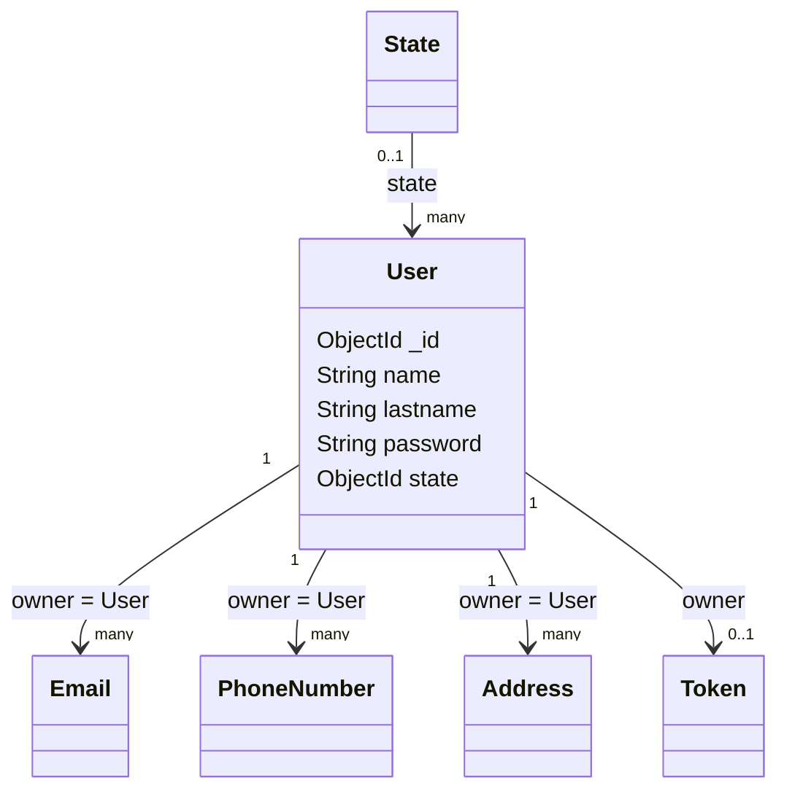

# User model

## Overview

`User` represents an authenticated application account. It stores the user's identity,
password credential, and optional state reference. Email, phone number, address, and messaging
tokens are stored as separate documents linked to the user identifier.

The model is created through the `OwlModel` factory:

```js
OwlModel("User", schemaDefinition, [], ["password"])
```

The password field is excluded from normal model output by the factory configuration. Password
hashing and comparison are provided by the shared model utility rather than implemented in the
schema file.

## Responsibilities

- Store the user's name and last name.
- Store the password credential using the common `OwlModel` password behavior.
- Optionally classify the account with a `State` reference.
- Serve as the owner of emails, phone numbers, addresses, and tokens.
- Provide the account resource used by authentication and dashboard features.

The schema does not embed the user's email, phone number, or addresses. Those resources are
created and loaded by `controllers/user.js`.

## Document structure



## Fields

| Field | Mongo/Mongoose type | Required | Rules and meaning |
| --- | --- | --- | --- |
| `_id` | `ObjectId` | Generated | MongoDB identifier generated for the user. |
| `name` | `String` | Yes | User's first or display name. Whitespace is trimmed. |
| `lastname` | `String` | Yes | User's last name. Whitespace is trimmed. |
| `password` | `String` | Yes | Password credential. It is trimmed, required, and hidden from normal output by `OwlModel`. |
| `state` | `ObjectId` | No | Optional reference to a `State` document. |

## Related resources

User-owned resources use the user's identifier and the corresponding `ownerType` value:

| Resource | Ownership fields |
| --- | --- |
| `Email` | `owner: user._id`, `ownerType: "User"` |
| `PhoneNumber` | `owner: user._id`, `ownerType: "User"` |
| `Address` | `owner: user._id`, `ownerType: "User"` |
| `Token` | `owner: user._id` |

During registration, the user is saved first. Related email, phone number, and address
documents are then saved in parallel. If a related save fails, the controller deletes the new
user to avoid an orphaned account.

## Validation and limitations

- `name`, `lastname`, and `password` are required.
- Text values are trimmed but have no maximum length in this schema.
- The schema does not define a unique username or email; email uniqueness belongs to `Email`.
- The schema does not enforce that the `state` document exists.
- Authentication, authorization, and session ownership are controller and middleware concerns.
- Related-resource cleanup is implemented by `controllers/user.js`, not by model hooks.

## Related files

- `models/user/user.js`: schema and model definition.
- `routes/user.js`: registration and authenticated account routes.
- `controllers/user.js`: related-resource creation and authenticated user operations.
- `controllers/auth.js`: login, logout, and session status.
- `models/email/email.js`: email used for login.
- `models/state/state.js`: referenced state model.
